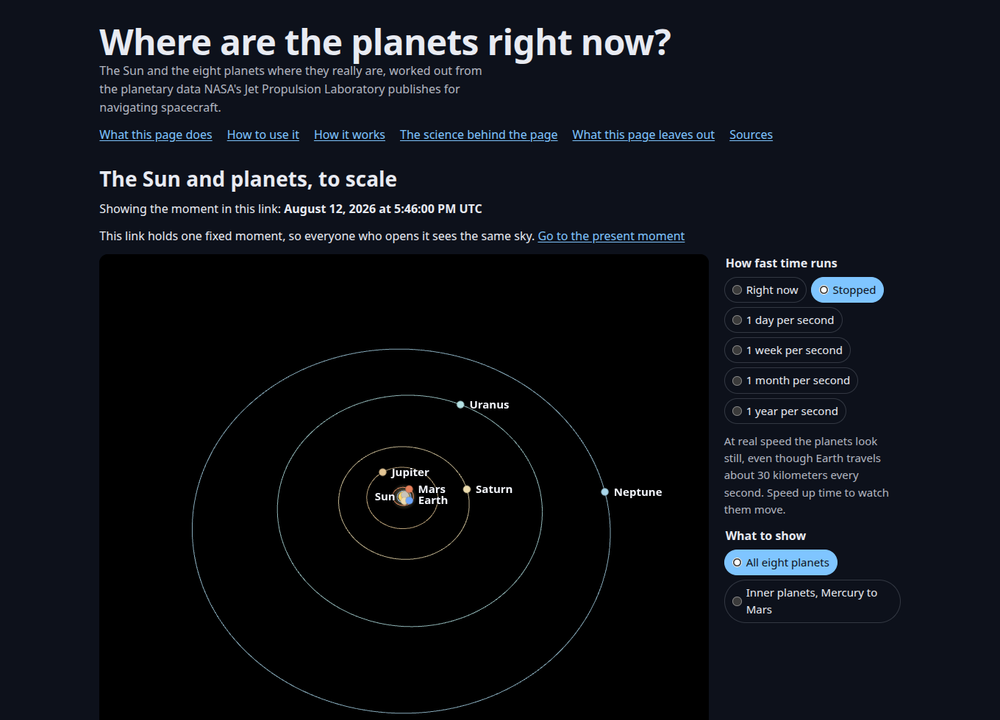
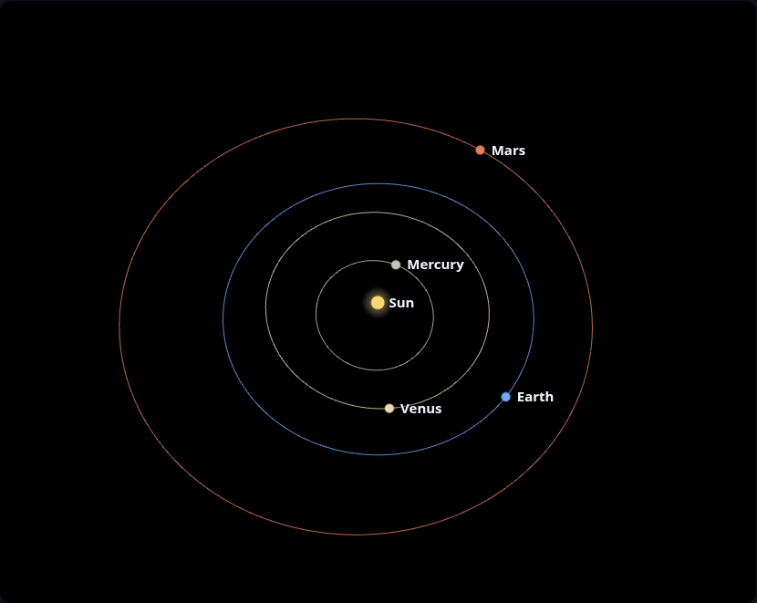
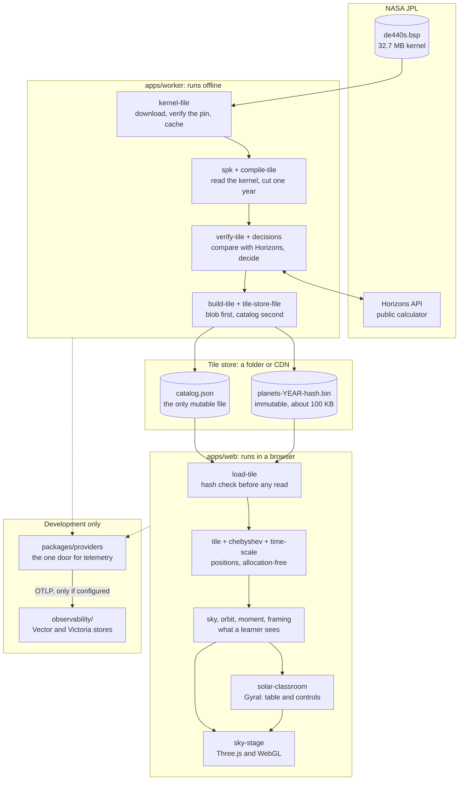
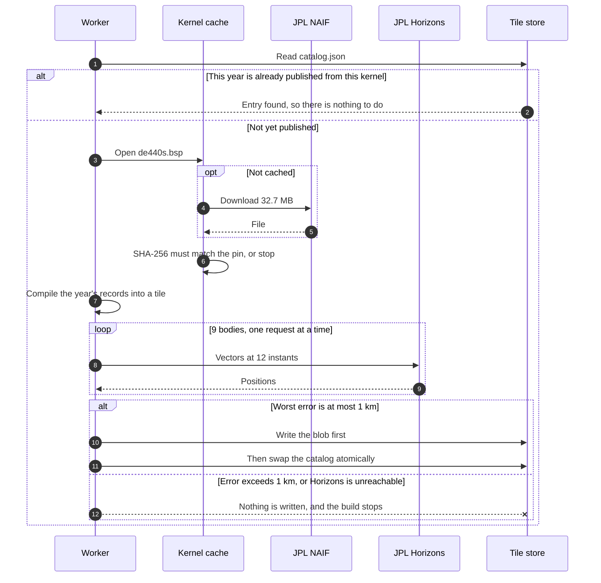
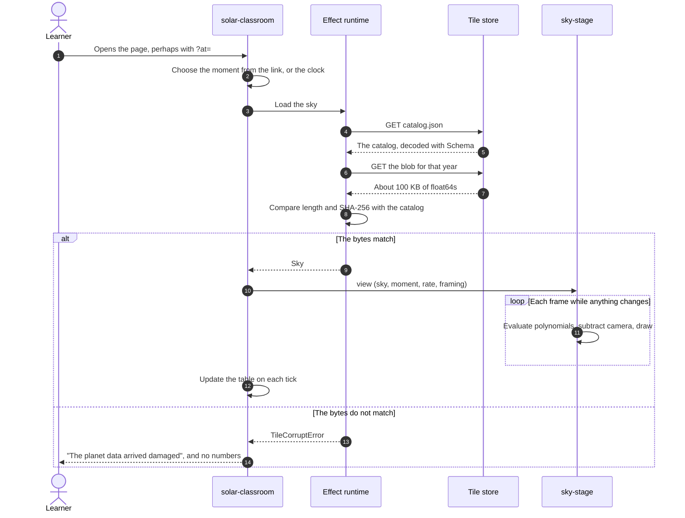
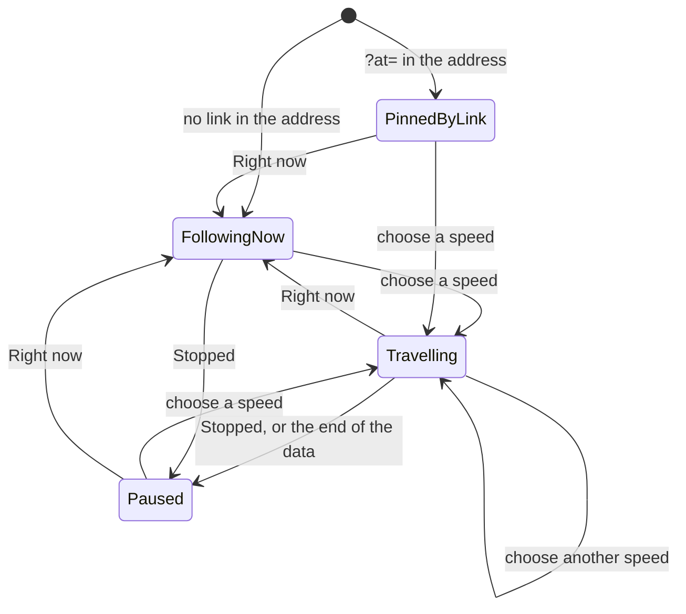
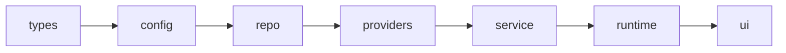
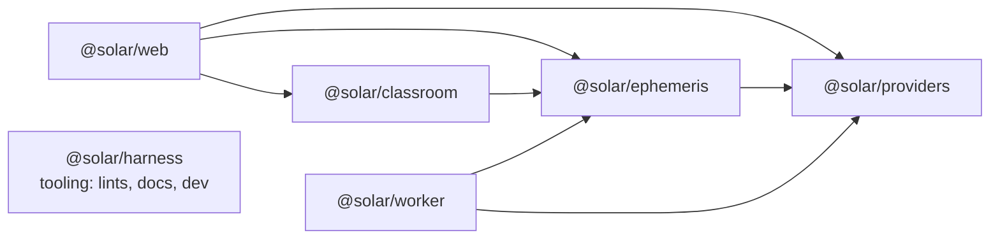
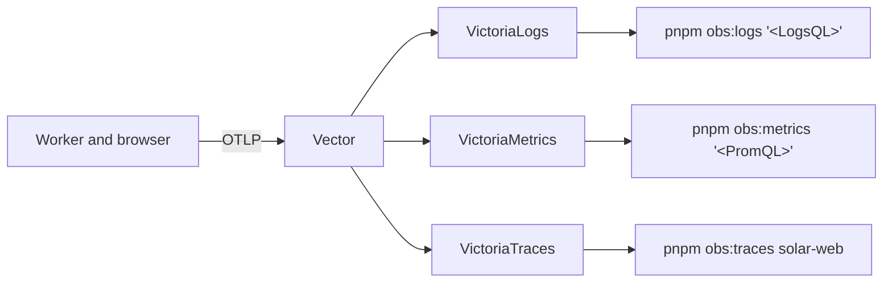

<div align="center">

# 🪐 Solar System Classroom

### Where are the planets right now?

A page for teachers and students that shows where the Sun and the eight planets **really are**, at **true scale**,<br/>
calculated from NASA JPL's planetary data and checked against JPL Horizons to within 5 meters.

<br/>

[](https://github.com/mikezupper/learn-solar-system/actions/workflows/ci.yml)
[](https://github.com/mikezupper/learn-solar-system/actions/workflows/codeql.yml)
[](https://github.com/mikezupper/learn-solar-system/actions/workflows/gardening.yml)
[](LICENSE)
[](package.json)
[](https://github.com/mikezupper/learn-solar-system/commits/main)
[](https://github.com/mikezupper/learn-solar-system/pulse)
[](https://github.com/mikezupper/learn-solar-system)

[](https://github.com/mikezupper/learn-solar-system/stargazers)
[](https://github.com/mikezupper/learn-solar-system/forks)
[](https://github.com/mikezupper/learn-solar-system/watchers)
[](https://github.com/mikezupper/learn-solar-system/graphs/contributors)
[](https://github.com/mikezupper/learn-solar-system/issues)
[](https://github.com/mikezupper/learn-solar-system/issues?q=is%3Aissue+is%3Aclosed)
[](https://github.com/mikezupper/learn-solar-system/pulls)
[](https://github.com/mikezupper/learn-solar-system/pulls?q=is%3Apr+is%3Aclosed)
[](https://github.com/mikezupper/learn-solar-system/discussions)
[](https://github.com/mikezupper/learn-solar-system/labels/good%20first%20issue)
[](CONTRIBUTING.md)
[](CODE_OF_CONDUCT.md)

[](https://github.com/mikezupper/learn-solar-system/search?l=typescript)
[](https://github.com/mikezupper/learn-solar-system)
[](https://github.com/mikezupper/learn-solar-system)
[](https://github.com/mikezupper/learn-solar-system)
[](https://github.com/mikezupper/learn-solar-system)

[](#the-data-jpl-de440)
[](#how-the-numbers-are-checked)
[](#how-the-numbers-are-checked)
[](#how-the-numbers-are-checked)
[](#how-the-numbers-are-checked)
[](#what-it-does)
[](#the-tile-format)
[](docs/guides/teaching.md)

[](.node-version)
[](pnpm-workspace.yaml)
[](https://www.typescriptlang.org/)
[](https://effect.website/)
[](https://gyral.dev/)
[](https://threejs.org/)
[](https://vite.dev/)
[](https://vitest.dev/)
[](https://playwright.dev/)
[](https://github.com/dequelabs/axe-core)
[](eslint.config.js)
[](observability/compose.yaml)
[](docs/design-docs/observability.md)
[](observability/vector.yaml)
[](observability/compose.yaml)
[](observability/compose.yaml)
[](observability/compose.yaml)

[](vitest.config.ts)
[](docs/RELIABILITY.md)
[](apps/web/e2e/where-are-the-planets.spec.ts)
[](tools/harness/src/rules/layers.ts)
[](docs/RELIABILITY.md)
[](docs/references/harness-engineering.md)
[](AGENTS.md)
[](CITATION.cff)

<br/>



<sub>The positions on August 12, 2026, the day of a total solar eclipse. Every distance in the picture is real.</sub>

</div>

> **Status: early, and open to you.** The page works, its numbers are checked, and its tests run on every change. **It
> has no public deployment yet, and no teacher has used it yet**, so its ideas about classrooms are guesses. You can
> run it in about a minute, and [your feedback](#contributing-and-community) would shape what comes next.

## Contents

- [What it does](#what-it-does)
- [Try it](#try-it)
- [The science](#the-science)
- [Technical architecture](#technical-architecture)
- [Tech stack](#tech-stack)
- [Build, test and run](#build-test-and-run)
- [Configuration](#configuration)
- [Deployment](#deployment)
- [Observability](#observability)
- [Directory structure](#directory-structure)
- [Repository conventions](#repository-conventions)
- [Contributing and community](#contributing-and-community)
- [Known limits and what comes next](#known-limits-and-what-comes-next)
- [Citation, license and credits](#citation-license-and-credits)

## What it does

The diagrams in most textbooks squeeze the planets together so that they fit on a page, which makes the solar system
look crowded. This page keeps every distance real, so you can see how empty the solar system actually is.

| You can | How |
|---|---|
| **See where every planet is right now** | A 3D view you can turn and zoom, with a dot for each planet and a line for the path it is following |
| **Watch the real motion** | Run time at a day, a week, a month or a year per second. Every frame asks JPL's data where each planet is on that date, so nothing is animated or estimated |
| **Read the numbers** | A table gives each planet's distance from the Sun and from Earth, and how long its light takes to reach us |
| **Frame the inner planets** | With all eight in view, the inner four share a few dozen pixels. A control moves the camera closer without changing any distance |
| **Show a class one moment** | A link such as `/?at=2026-08-12T17:46:00Z` holds one moment, so that everyone sees the same positions and numbers |
| **Learn how it all works** | The page explains how to use it, how it works and the science behind it, in language for readers with no astronomy background |

<div align="center">

<br/>
<sub>The inner view moves the camera closer. Neither view changes a distance.</sub>
</div>

### Who it is for

**Teachers and students**, with no astronomy background assumed, on an ordinary school laptop, with no account or
install. [The guide for teachers](docs/guides/teaching.md) has ten-minute activities, which are untested so far.

### What it refuses to do

Accuracy is the product, which leads to some unusual behavior:

- **It would rather show nothing than something wrong.** If a data file arrives damaged, the page says so in plain words
  and shows no numbers.
- **The planets are dots.** At true scale, with all eight in view, one pixel covers about 18 million kilometers, so even
  the Sun would be less than a tenth of a pixel. A dot marks a position, and its size means nothing.
- **It holds still at first.** At real speed, Earth needs about a week to cross one pixel. The page says so, and leaves
  the choice to speed up to the learner.
- **The numbers never depend on the picture.** The table works whether or not the browser can start WebGL.

## Try it

You need [Node.js 24](https://nodejs.org/) and [pnpm](https://pnpm.io/), which `corepack enable` provides. This runs the
real page on real data for 2026 and 2027, with no Docker and no downloads from JPL:

```sh
git clone https://github.com/mikezupper/learn-solar-system.git
cd learn-solar-system
corepack enable
pnpm bootstrap
pnpm dev:quick
```

Open the address it prints, and add `?at=2026-08-12T17:46:00Z` to it. Mars's row should read 1.495 AU from the Sun, 1.947
AU from Earth, and 16.2 minutes of light travel.

## The science

This section is for readers comfortable with some math. The page itself explains the same ideas in plainer language.

### The data: JPL DE440

Nothing here is a live feed, because a planet's position is not news. NASA's Jet Propulsion Laboratory publishes the
**Development Ephemeris**, a fixed model of the solar system, and DE440 is the current general-purpose version
([Park et al. 2021](https://doi.org/10.3847/1538-3881/abd414)).

JPL builds it by numerically integrating the equations of motion for the Sun, the planets and the Moon, together with
343 asteroids, 30 Kuiper belt objects, and a ring standing in for the rest of the belt. It then fits the initial
conditions to observations. Those include radio ranging and VLBI to spacecraft (MESSENGER, Venus Express, the Mars
orbiters, Juno and Cassini) and laser ranging to reflectors on the Moon. The MESSENGER range residuals are about 0.7 m rms.

This project reads **`de440s.bsp`**, the 32.7 MB short version that NASA's NAIF team publishes, which covers 1849 to 2150.
Its hash is pinned in [`data/kernels.lock.json`](data/kernels.lock.json), and the worker stops if the file differs.

### From polynomials to positions

An SPK kernel stores each body's path as a sequence of Chebyshev polynomial records. A record holds $n$ coefficients for
each of three axes, over an interval $\Delta t$ that starts at $t_0$:

```math
x(t) = \sum_{k=0}^{n-1} c_k\, T_k(s), \qquad s = \frac{2\,(t - t_0)}{\Delta t} - 1, \qquad
T_0 = 1,\;\; T_1 = s,\;\; T_{k+1} = 2s\,T_k - T_{k-1}
```

[`chebyshev.ts`](packages/ephemeris/src/service/chebyshev.ts) evaluates this with Clenshaw's recurrence, which allocates
nothing and is numerically stable. This is the hot path, running once per axis, per body, per frame:

```math
b_{n} = b_{n+1} = 0, \qquad b_k = 2s\,b_{k+1} - b_{k+2} + c_k, \qquad x = s\,b_1 - b_2 + c_0
```

Records are sized to each body's motion. Those are real figures from the kernel:

| Segment (NAIF target / center) | Interval | Coefficients per axis |
|---|---|---|
| Mercury barycenter (1/0) | 8 days | 14 |
| Venus barycenter (2/0) | 16 days | 10 |
| Earth-Moon barycenter (3/0) | 16 days | 13 |
| Earth and the Moon, each relative to their barycenter (399/3, 301/3) | 4 days | 13 |
| Sun (10/0) | 16 days | 11 |
| Mars barycenter (4/0) | 32 days | 11 |
| Jupiter barycenter (5/0) | 32 days | 8 |
| Saturn barycenter (6/0) | 32 days | 7 |
| Uranus, Neptune and Pluto barycenters (7/0, 8/0, 9/0) | 32 days | 6 |

To find a body's position, [`tile.ts`](packages/ephemeris/src/service/tile.ts) sums the chain of segments from that body up
to the solar-system barycenter. Earth, for example, is Earth relative to the Earth-Moon barycenter, plus that barycenter
relative to the solar-system barycenter.

### Time scales

JavaScript counts UTC, but the kernels count seconds past J2000 in Barycentric Dynamical Time (TDB). In 2026 they differ by
69.184 s, and Earth covers about 2,000 km in that time, so ignoring the difference would be a visible error at this
precision. [`time-scale.ts`](packages/ephemeris/src/service/time-scale.ts) is the only place that converts, using a table
of leap seconds from IERS Bulletin C and the constants in NAIF's `naif0012.tls`:

```math
\mathrm{TT} = \mathrm{UTC} + \Delta\mathrm{AT} + 32.184\,\mathrm{s}
```

```math
M = 6.239996 + 1.99096871 \times 10^{-7}\, t_{\mathrm{TT}}, \quad
E = M + 0.01671 \sin M, \quad
\mathrm{TDB} = \mathrm{TT} + 0.001657 \sin E
```

### Frames and origins

**Axes.** JPL's data uses the International Celestial Reference Frame (ICRF), whose axes lie close to Earth's equator. The
stage turns them around the $x$ axis by the J2000 obliquity, $\varepsilon = 84381.448''$ (about 23.44°), so that the plane
of Earth's orbit lies flat ([`sky.ts`](packages/classroom/src/service/sky.ts)):

```math
x' = x, \qquad y' = y\cos\varepsilon + z\sin\varepsilon, \qquad z' = z\cos\varepsilon - y\sin\varepsilon
```

**Origin.** The stage is centered on the solar-system barycenter, as JPL's data is, while the table measures from the
Sun's center. The two are not the same point. Measured daily across 2000 to 2050, the barycenter lies between 93,000 and
1.38 million km from the Sun's center, which is up to 1.98 solar radii.

**Barycenters and centers.** Mercury, Venus and Earth use the body's own center. DE440s gives only the system barycenter for
Mars through Neptune, which is at most a few hundred kilometers from the planet's center. One unit in the last place of
the table is about 150,000 km.

### Orbit lines

Each line is an **osculating orbit**: the ellipse a planet would follow if only the Sun pulled on it, calculated in the
browser from its state at the moment shown ([`orbit.ts`](packages/classroom/src/service/orbit.ts)). Velocity comes from a
central difference of the tile's track, one hour on either side, and $\mu$ is the sum of the Sun's and the planet system's
$GM$, from JPL's `gm_de440.tpc`. With heliocentric position $\mathbf{r}$ and velocity $\mathbf{v}$:

```math
\mathbf{h} = \mathbf{r} \times \mathbf{v}, \qquad
\mathbf{e} = \frac{\mathbf{v} \times \mathbf{h}}{\mu} - \frac{\mathbf{r}}{|\mathbf{r}|}, \qquad
\frac{1}{a} = \frac{2}{|\mathbf{r}|} - \frac{|\mathbf{v}|^2}{\mu}, \qquad
\rho(\theta) = \frac{|\mathbf{h}|^2 / \mu}{1 + |\mathbf{e}|\cos\theta}
```

Other bodies pull on the planet too, so its real path drifts from any one ellipse. Measured against DE440s, as the distance
from the real position to the drawn line ([the design note](docs/design-docs/orbit-lines.md)):

| Planet | Drift over one year (AU) | Drift over one full orbit (AU) |
|---|---|---|
| Mercury, Venus | under 0.0001 | under 0.0001 |
| Earth | 0.0001 | 0.0001 |
| Mars | 0.0001 | 0.0002 |
| Jupiter | 0.0001 | 0.0015 |
| Saturn | 0.0001 | 0.0125 |
| Uranus | 0.0002 | 0.1410 |
| Neptune | 0.0004 | 0.0670 |

One pixel is about 0.006 AU in the inner view and 0.12 AU in the whole-system view. The stage redraws each line every 30
simulated days, so what a learner sees is the one-year column. Earth's line follows the Earth-Moon barycenter, because
Earth itself wobbles around that point by about 4,700 km every month, and an ellipse that followed it would shiver.

### Distances and light

Distances in the table are straight lines at one instant, in astronomical units: exactly 149,597,870.7 km, as defined by
IAU 2012 Resolution B2. Light travel time is that distance divided by exactly 299,792.458 km/s. These are **geometric**
positions, with no correction for light time or aberration, so the page says where a planet is, not where it appears
in your sky. (The eclipse check below does apply light-time correction.)

### Precision at the GPU

Near Neptune's orbit, about $4.5 \times 10^9$ km out, the 32-bit floats a GPU uses can resolve only 512 km. So positions stay
64-bit until the camera is subtracted ([`framing.ts`](packages/classroom/src/service/framing.ts)), and the GPU sees only small
camera-relative numbers. `cameraRelative` is the only way a position reaches the GPU.

### How the numbers are checked

The project's own rule is that **an expected value comes from outside the code**: JPL, a published catalog or a definition,
and never the code's own output.

| Claim | Checked against | Result | Where | Runs |
|---|---|---|---|---|
| A published tile agrees with JPL | **Live JPL Horizons**, which runs DE441, a sister solution to DE440: 12 instants × 9 bodies × 51 years = 5,508 comparisons | **Worst 4.7 m**; the limit is 1 km | [`verify-tile.ts`](packages/ephemeris/src/service/verify-tile.ts) | At publish, and a failure blocks it |
| The evaluator is right | Recorded Horizons answers for 2026 | Under 3 m; the limit is 5 m | [`golden.test.ts`](packages/ephemeris/test/golden.test.ts) | Every change |
| It predicts a real eclipse | [NASA's eclipse catalog](https://eclipse.gsfc.nasa.gov/SEcat5/SE2001-2100.html) for 2026-08-12: greatest eclipse at 17:47:06 TD, gamma 0.8977 | Within 1 s and 0.0002 | [`golden.test.ts`](packages/ephemeris/test/golden.test.ts) | Every change |
| Each orbit has the right shape | [NASA's planetary fact sheets](https://nssdc.gsfc.nasa.gov/planetary/factsheet/) | Size, eccentricity, tilt and top speeds agree | [`orbit.test.ts`](packages/classroom/test/orbit.test.ts), [`explanation.test.ts`](apps/web/test/explanation.test.ts) | Every change |
| The page's static text is right | The tile, and Kepler's third law | Every table row and lap time | [`explanation.test.ts`](apps/web/test/explanation.test.ts) | Every change |
| The screen shows those numbers | Recorded Horizons, read off the rendered table | Exact at the printed precision | [`where-are-the-planets.spec.ts`](apps/web/e2e/where-are-the-planets.spec.ts) | Every change |
| The worker is deterministic | The same kernel and dates | Identical bytes and hash | [`pipeline.kernel.test.ts`](apps/worker/test/pipeline.kernel.test.ts) | Every change, in CI |

**What this does not show.** These checks show that this project copies and evaluates JPL's data faithfully. They do not
measure how close JPL's model is to the real planets. For that, read the DE440 paper.

### What the page does not show

Planet sizes; moons and spin; dwarf planets, asteroids and comets; where to look in your own sky; dates outside 2000 to 2050;
and time running backward. [Known limits](#known-limits-and-what-comes-next) says which are on the way.

## Technical architecture

### Two halves that never run at the same time

Planet positions are a fixed model, so nothing new appears by polling for them. The system therefore has an offline
half that prepares verified data, and a browser half that evaluates it. **The page ships the polynomials themselves, not
sampled positions.** That lets it answer any moment, at any frame rate, with no server behind it.

### Component diagram



`packages/ephemeris` holds the tile logic on both sides, so the same code that publishes a tile also reads it. `packages/classroom`
holds `sky`, `orbit`, `moment` and `framing`, and the stage is the only code that touches Three.js.

### Publishing a year



A crash between the two writes leaves at most an unlisted blob, which a rerun reuses. No reader can ever find a listing
with no file behind it.

### Opening the page



### How time behaves

The moment on screen is a tagged union, so each state holds only what it needs and an impossible combination cannot be
written down ([`classroom/types`](packages/classroom/src/types/index.ts)):



A tick counts at most one real second, so a laptop waking from sleep makes time wait and does not leap years ahead past
tiles it never loaded.

### Packages and layers

Every package divides into fixed layers, and code imports only earlier ones. A custom lint enforces this, using TypeScript's
own parser, and its message says how to fix a violation ([`layers.ts`](tools/harness/src/rules/layers.ts)).





| Layer | Holds | May not |
|---|---|---|
| `types` | Schemas, brands, tagged unions, errors | Do anything |
| `config` | Settings read at the edge | Touch the network or disk |
| `repo` | Ports, and adapters to the outside world | Contain business rules |
| `providers` | Cross-cutting concerns | Know about any domain |
| `service` | Workflows and pure logic | Name a concrete adapter |
| `runtime` | Wiring, and the one place Effects run | Contain logic |
| `ui` | Gyral components and the WebGL stage | Fetch or compute positions itself |

The lint also restricts specific imports. Only the stage may import Three.js, so everything else runs and tests without a GPU.
Node APIs stay in the worker and tools, so the domain also runs in browsers. Telemetry export lives only in `providers`.

### The tile format

There is no database. Tiles are **derived data**: deterministic, immutable and rebuildable from the kernel. A catalog lists
them, and this is real output, shortened:

```jsonc
{
  "formatVersion": 1,                // decoding fails on an unknown version, so a stale page errors and does not misread
  "tiles": [{
    "id": "planets-2026",
    "system": "planets",
    "year": 2026,
    "startSeconds": 820497669.18392, // TDB seconds past J2000
    "endSeconds": 852033669.1839125,
    "blob": "planets-2026-6c54357f7df349b7.bin", // the name contains the hash, so it can be cached forever
    "byteLength": 104400,
    "sha256": "6c54357f7df349b76bb5a36eb9ef22985fcdf3425e2eebc6f23c35dd0c772adb",
    "segments": [{
      "target": 1, "center": 0,      // NAIF IDs: Mercury barycenter relative to the solar-system barycenter
      "initSeconds": 820411200,
      "intervalSeconds": 691200,     // 8 days
      "coefficientsPerAxis": 14,
      "recordCount": 46,
      "byteOffset": 0
    } /* … 13 more */],
    "provenance": { "kernel": "de440s.bsp", "kernelSha256": "c1c7feea…" },
    "verification": {                // the evidence that let this tile through the publish gate
      "source": "JPL Horizons API",
      "instantsChecked": 12, "bodiesChecked": 9,
      "maxErrorKm": 0.0025, "limitKm": 1
    }
  }]
}
```

A blob is a flat array of little-endian doubles, ordered by record, then axis, then coefficient. MID, RADIUS and velocity
coefficients are dropped, since position is all the page needs. Tiles are partitioned by calendar year, because a learner's moment
falls in exactly one year: 104,400 bytes for 2026, and 5.4 MB for 2000 to 2050.
[The design note](docs/design-docs/tile-data.md) records the alternatives, including why this does not call Horizons at page
load: Horizons sends no CORS headers and is a shared service.

### Invariants

These hold everywhere, and [ARCHITECTURE.md](ARCHITECTURE.md) is the full list.

- **A rejected tile is never published.** `buildYearTile` returns before it touches the store.
- **A tile's bytes are checked before any number is read from them.**
- **A published blob never changes**, and the blob is written before the catalog.
- **Time is TDB inside the domain.** UTC becomes TDB in `tdbFromUtcMillis` and nowhere else.
- **Positions stay 64-bit until the camera is subtracted.**
- **Reducers and views are pure.** The page's facts, including the clock, arrive as messages.
- **Telemetry goes nowhere unless configured.**

### When things go wrong

| Failure | What happens |
|---|---|
| A downloaded kernel differs from its pin | The worker stops and keeps nothing |
| A tile disagrees with Horizons, or Horizons is unreachable | The store is untouched, because unverified is not verified |
| The catalog cannot be fetched, or has a newer format | The page says the data could not be loaded |
| A tile arrives damaged | The page refuses it and shows no numbers |
| SHA-256 is unavailable, over plain `http` | The page asks for an `https` address |
| WebGL will not start | The stage reports it, and the table remains |
| A date falls outside the catalog | The page names the years it has |
| Time runs past the last published year | Time stops, and the page says why |

[docs/RELIABILITY.md](docs/RELIABILITY.md) has the complete list, with the file behind each.

## Tech stack

Versions are pinned exactly in [`pnpm-workspace.yaml`](pnpm-workspace.yaml), and the badges above read them from there.

| Area | Technology | Why |
|---|---|---|
| Language | [TypeScript](https://www.typescriptlang.org/) 6, strict | One toolchain for the worker, the domain and the page. Not 7 yet, because typescript-eslint and Gyral's tooling need 6.x |
| Domain and errors | [Effect](https://effect.website/) 4 | Typed errors, `Schema` at the boundaries, and capabilities as services. The same rules hold on Node and in browsers |
| UI components | [Gyral](https://gyral.dev/) 0.3 | Model-View-Intent custom elements. Reducers are pure, so component logic tests in Node in milliseconds |
| 3D | [Three.js](https://threejs.org/) 0.187, WebGL | Confined to the stage by lint |
| Styling | Modern CSS, no framework | Cascade layers, container queries, logical properties, oklch, `light-dark()` |
| Build | [Vite](https://vite.dev/) 8 | One static page plus a plain document |
| Runtime | [Node.js](https://nodejs.org/) 24 | The worker and tooling. There is no server in production |
| Workspace | [pnpm](https://pnpm.io/) 10 | Workspace, shared version catalog, build-script allowlist |
| Unit and browser tests | [Vitest](https://vitest.dev/) 5 | Three projects: unit, browser and kernel |
| End-to-end tests | [Playwright](https://playwright.dev/) 1.64, [axe](https://github.com/dequelabs/axe-core) | Real builds, real WebGL in software, accessibility in both color schemes |
| Linting | [ESLint](https://eslint.org/), typescript-eslint, and custom lints | Effect's rules, plus layers, taste and docs |
| Telemetry | [OpenTelemetry](https://opentelemetry.io/) (OTLP), [Vector](https://vector.dev/), [VictoriaLogs, VictoriaMetrics, VictoriaTraces](https://victoriametrics.com/) | A disposable stack per worktree, in development only |
| CI | GitHub Actions, CodeQL | See [What CI runs](#what-ci-runs) |
| Data | [NAIF SPICE kernels](https://naif.jpl.nasa.gov/naif/), [JPL Horizons](https://ssd.jpl.nasa.gov/horizons/) | The system of record, and an independent check |

The page ships about 213 KiB of gzipped JavaScript, most of it Three.js, against a 240 KiB budget that fails the build. The SPK reader
is a [small file in this repository](packages/ephemeris/src/service/spk.ts) and not a dependency, so that everything stays in one
toolchain and can be read and tested here.

## Build, test and run

### Prerequisites

| Tool | Version | Needed for |
|---|---|---|
| Node.js | 24 (`.node-version` pins 24.15.0) | Everything |
| pnpm | 10.33.2, via `corepack enable` | Everything |
| Chromium for Playwright | `pnpm --filter @solar/web exec playwright install chromium` | `pnpm verify` |
| Docker with Compose | Any recent version | Only `pnpm dev` and `pnpm obs:*` |

### Commands

| Command | What it does |
|---|---|
| `pnpm bootstrap` | Fetches the public skills and installs dependencies |
| `pnpm dev:quick` | The page on 2026 and 2027 fixture data, with no Docker or downloads |
| `pnpm dev` | This worktree's whole environment: telemetry stack, data for 2000 to 2050, and web server, on its own ports |
| `pnpm dev:stop` | Stops `pnpm dev` and removes its containers |
| `pnpm harness where` | Prints this worktree's project name and ports as JSON |
| `pnpm tiles:build` | Compiles, checks against Horizons, and publishes any missing years |
| `pnpm build` | Builds the page into `apps/web/dist` |
| `pnpm test` | Unit tests: no network, browser or kernel |
| `pnpm test:browser` | Gyral elements in real Chromium |
| `pnpm test:kernel` | Against the real JPL kernel, downloaded once to a shared cache |
| `pnpm e2e` | Acceptance tests against the built page. Run `pnpm build` first |
| `pnpm coverage` | Unit tests with a line-coverage gate of 85% |
| `pnpm verify` | Every check that needs neither Docker nor the kernel |
| `pnpm verify:full` | `verify`, plus document freshness, the real kernel and the telemetry stack |
| `pnpm gen-docs` | Regenerates `docs/generated/` |

### The gates

`pnpm verify` runs all of these, and each failure message says how to fix it:

| Gate | Enforces |
|---|---|
| `pnpm typecheck` | Strict TypeScript across the workspace |
| `pnpm lint` | No `throw`, `try`, `async`, `console`, `process.env`, `null` or casts in application code; no `let` or loops outside listed hot paths |
| `pnpm lint:layers` | Layer and package directions, and restricted imports |
| `pnpm lint:docs` | Links resolve, every document is reachable from `AGENTS.md`, and design documents carry a status |
| `pnpm lint:taste` | Source files under 400 lines; no `class`, `style`, `div` or `span` in views; logical properties and oklch in CSS |
| `pnpm gen-docs --check` | Generated documents match the code |
| `pnpm quality --check` | Every package has a grade |
| `pnpm coverage` | Unit tests pass, with at least 85% of lines covered. On 2026-10-31 it stood at 95.9% |
| `pnpm test:browser` | Components work in a real browser |
| `pnpm build`, `pnpm budget` | At most 240 KiB of gzipped JavaScript |
| `pnpm e2e` | Acceptance tests, including axe in both color schemes |

### What CI runs

| Workflow | When | Jobs |
|---|---|---|
| [CI](.github/workflows/ci.yml) | Every push to `main` and every pull request | `verify` runs `pnpm verify`; `kernel` runs against the real JPL kernel; `telemetry` starts the stack and proves all three signals arrive |
| [CodeQL](.github/workflows/codeql.yml) | Every push and pull request, and weekly | Static security analysis of the TypeScript |
| [Gardening](.github/workflows/gardening.yml) | Weekly, or by hand | Finds documents nobody has re-verified in 30 days, ungraded packages and drifted generated files |

Document freshness runs on a schedule and not in pull requests, because it depends on the date and not on the change: a
contributor's branch should not turn red because a maintainer's calendar ran out.

## Configuration

No setting is required, and no secrets exist. Copy [`.env.example`](.env.example) to `.env`, which Git ignores, for local settings.

| Variable | Read by | Default | Purpose |
|---|---|---|---|
| `ALLOWED_HOSTS` | Vite dev and preview servers, from `.env` | Empty | Names to answer to besides `localhost`, comma-separated. `.example.com` allows a domain and its subdomains. Real hostnames belong here, never in code |
| `TILE_STORE_DIR` | Worker, and Vite's servers | `.harness/tiles` | Where tiles are written and served from |
| `TILE_YEARS` | Worker | `2000-2050` | Years to publish, as in `2000-2050, 2060` |
| `KERNEL_CACHE_DIR` | Worker | `~/.cache/solar-system/kernels` | Shared kernel cache |
| `KERNEL_LOCK_FILE` | Worker | `data/kernels.lock.json` | Pinned kernels |
| `OTEL_EXPORTER_OTLP_ENDPOINT` | Worker | Unset, so no telemetry | Where the worker sends telemetry |
| `HARNESS_WORKTREE` | Worker | `unset` | Labels telemetry with the worktree |
| `VITE_TILE_BASE_URL` | Page, at build time | `/tiles` | Where the page finds tiles |
| `VITE_OTLP_BASE_URL` | Page, at build time | Unset, so no telemetry | Where the page sends telemetry |
| `VITE_WORKTREE` | Page, at build time | `unset` | Labels telemetry with the worktree |
| `HARNESS_OTLP_TARGET` | Vite dev server | Unset | The collector behind the `/otlp` proxy |

`pnpm dev` sets the worker and telemetry variables itself. Ports come from a hash of the worktree's path, below 32768 so that they
stay out of Linux's ephemeral range, which lets several worktrees run side by side.

**Pinning a kernel.** [`data/kernels.lock.json`](data/kernels.lock.json) names the kernel's URL, size and SHA-256. Treat a change to it as
a decision: the whole accuracy claim rests on that file.

## Deployment

**There is no public deployment yet.** The site is static, with no server code, database or secrets, so it can go on any static host.
[The deployment guide](docs/guides/deployment.md) has the details. In short:

```sh
pnpm install --frozen-lockfile
pnpm tiles:build                         # about two minutes for 51 years; writes .harness/tiles
pnpm build                               # writes apps/web/dist
mkdir -p apps/web/dist/tiles
cp .harness/tiles/* apps/web/dist/tiles/ # then upload apps/web/dist
```

A host must serve the site **at the root of a domain**, because its links start from `/`, and over **HTTPS**, because the page checks
its data with SHA-256, which browsers offer only on `https` and `localhost`. Tiles may live on another origin, if it sends
`Access-Control-Allow-Origin` and you build with `VITE_TILE_BASE_URL`.

| Files | `Cache-Control` |
|---|---|
| `tiles/catalog.json`, `*.html` | `no-cache` |
| `tiles/*.bin`, `assets/*` | `public, max-age=31536000, immutable` |

Upload `.bin` files before `catalog.json`. These steps were rehearsed on a plain static server over `localhost`, not with any
particular hosting company.

## Observability

Every worktree can run its own disposable telemetry stack, so that an agent can query what its change did:



This is more than the app needs today, by decision: the project owner chose to follow the harness-engineering approach in full. The stack
stays cheap, since it has no volumes, binds to `127.0.0.1` only, and runs only when a command starts it. **Deployed pages and CI's unit
tests send nothing**, because with no endpoint, `telemetryLayer` is the empty layer.

[The metrics are listed here](docs/generated/instruments.md), and [the design note](docs/design-docs/observability.md) explains the choices.

## Directory structure

```text
.
├── apps/
│   ├── web/                        The page
│   │   ├── index.html              The page's shell and its full explanation, as static HTML
│   │   ├── about-the-data.html     A plain document with no CSS or script, on purpose
│   │   ├── src/
│   │   │   ├── config/             Build-time settings and allowed hosts
│   │   │   ├── runtime/            app-runtime.ts, the one place Effects run; driver tokens
│   │   │   ├── service/            load-sky.ts: catalog, tile, Sky
│   │   │   ├── types/
│   │   │   ├── ui/                 classroom.ts and classroom-model.ts (component and reducers),
│   │   │   │                       stage.ts and stage-scene.ts (WebGL), copy.ts (every rendered sentence)
│   │   │   └── styles.css          Cascade layers, oklch tokens
│   │   ├── test/                   Model tests, browser tests, and tests of the page's text
│   │   └── e2e/                    Acceptance tests against the built page
│   └── worker/                     The Node batch job that publishes tiles
│       ├── src/{config,repo,runtime,service}/
│       └── test/                   Includes *.kernel.test.ts, against the real kernel
├── packages/
│   ├── ephemeris/                  Tiles and positions; runs on Node and in browsers
│   │   ├── src/types/              Bodies, catalog, errors, kernel, tile, time
│   │   ├── src/repo/               Ports and adapters: Horizons, kernels, tile store, digest
│   │   ├── src/service/            spk, compile-tile, chebyshev, tile, time-scale, verify-tile,
│   │   │                           decisions, build-tile, load-tile
│   │   └── test/                   Includes golden.test.ts: Horizons and a real eclipse
│   ├── classroom/                  What a learner sees: sky, orbit, moment, framing
│   └── providers/                  Metrics, and the one door for telemetry
├── tools/harness/                  Custom lints, generated docs, per-worktree boot, telemetry queries
│   └── src/rules/                  The rules, as pure functions
├── data/kernels.lock.json          The hash-pinned JPL kernel
├── fixtures/                       Real data used as expected values
│   ├── tiles/                      Genuine worker output for 2026 and 2027
│   └── horizons/                   Answers recorded from JPL
├── observability/                  Docker Compose and Vector config for the telemetry stack
├── docs/
│   ├── guides/                     Deploying, and using the page with a class
│   ├── product-specs/              What the product does, slice by slice
│   ├── design-docs/                Decisions and their reasons; core beliefs; golden principles
│   ├── exec-plans/                 Plans, with progress and decision logs; the debt tracker
│   ├── generated/                  Derived from the code. Never edit by hand
│   ├── references/                 The contracts of outside systems
│   └── *.md                        DESIGN, FRONTEND, PLANS, PRODUCT_SENSE, QUALITY_SCORE, RELIABILITY, SECURITY
├── skills/                         Written standards as submodules (four are private), and two of our own
├── .github/                        CI, CodeQL, Gardening, and issue and pull-request templates
├── AGENTS.md                       The map, for agents and for anyone new
├── ARCHITECTURE.md                 The code map, layers and invariants
├── CONTRIBUTING.md                 How to contribute
└── README.md                       You are here
```

## Repository conventions

[CONTRIBUTING.md](CONTRIBUTING.md) has the working details. The ones that shape everything are these:

- **Accuracy comes from outside.** An expected value in a test comes from JPL, a published catalog or a definition, and never from
  running the code and pasting the result.
- **Test first.** Write a failing test, and see it fail for the right reason.
- **Rules are mechanical.** A rule that matters has a lint, and its message says how to fix the violation. If a rule blocks you, fix the
  design, or change the rule and its reason together.
- **Parse at the boundary, once.** Errors are typed values. Time and randomness are inputs.
- **Markup means something.** Views use specific elements, styled by element or attribute. There is no `class`, `style`, `div` or `span`.
- **The repository is the system of record.** If a decision is not written down here, the next person or agent cannot see it. Plans and
  their decision logs are checked in, and documents carry a status and the date someone last verified them.
- **Real hostnames stay out of Git.** They go in `.env`.
- **Commit messages are imperative**, and this project's commits carry no attribution trailers.

### How this repository is built

This project follows [harness engineering](docs/references/harness-engineering.md): a person sets direction and judges results, and coding
agents write the code, tests and documents. Effort goes into the environment that makes that reliable: the lints, tests, documents and
per-worktree tooling. That is why [`AGENTS.md`](AGENTS.md) is a short map and not a manual. Contributions are welcome however you write them.

## Contributing and community

Help is welcome, and much of the most useful help needs no code. **A teacher's view is what this project lacks most.**

| Guide | For |
|---|---|
| [CONTRIBUTING.md](CONTRIBUTING.md) | Setting up, making a change, conventions, troubleshooting |
| [CODE_OF_CONDUCT.md](CODE_OF_CONDUCT.md) | How we treat each other |
| [SECURITY.md](SECURITY.md) | Reporting a vulnerability privately |
| [SUPPORT.md](SUPPORT.md) | Where to ask questions |
| [Using the page with a class](docs/guides/teaching.md) | Teachers |
| [Deploying your own copy](docs/guides/deployment.md) | Anyone hosting it |
| [CHANGELOG.md](CHANGELOG.md) | What has changed |
| [AGENTS.md](AGENTS.md), [ARCHITECTURE.md](ARCHITECTURE.md) | Finding your way around the code |
| [docs/QUALITY_SCORE.md](docs/QUALITY_SCORE.md) | An honest grade for each part, with its known gaps |

Open an issue: [a number looks wrong](https://github.com/mikezupper/learn-solar-system/issues/new?template=accuracy_report.yml),
[classroom feedback](https://github.com/mikezupper/learn-solar-system/issues/new?template=classroom_feedback.yml),
[a bug](https://github.com/mikezupper/learn-solar-system/issues/new?template=bug_report.yml), or
[a feature](https://github.com/mikezupper/learn-solar-system/issues/new?template=feature_request.yml). Or start a
[discussion](https://github.com/mikezupper/learn-solar-system/discussions).

## Known limits and what comes next

[The debt tracker](docs/exec-plans/tech-debt-tracker.md) lists each limit with what should trigger fixing it.

| Limit | Why it matters |
|---|---|
| No public deployment | The page has no home yet |
| No keyboard control of the 3D view | Keyboard users cannot turn or zoom it, though the table carries every number |
| No moons, spin or textures | The main promises beyond positions, and the next slices |
| Mars through Neptune are barycenters | Off by a few hundred kilometers; matters only for close views, and moon kernels would fix it |
| Time runs forward only, with no date picker | A teacher reaches a date by writing a link |
| Data covers 2000 to 2050 | Uranus and Neptune cannot finish an orbit |
| Leap seconds are a table in the code | A new one would need a release, though none has been added since 2017 |
| No strict Content-Security-Policy | Needed before public deployment |
| One tile writer at a time | The catalog has no compare-and-swap |

## Citation, license and credits

### Citing this project

GitHub's **Cite this repository** button uses [`CITATION.cff`](CITATION.cff). If you use the planetary data, please also cite:

> Park, R. S., Folkner, W. M., Williams, J. G., and Boggs, D. H. (2021). The JPL Planetary and Lunar Ephemerides DE440 and DE441.
> *The Astronomical Journal*, 161:105. [doi:10.3847/1538-3881/abd414](https://doi.org/10.3847/1538-3881/abd414)

### License

This project's code and documents are released under the [MIT License](LICENSE). That does not extend to things it uses or points to:

- **JPL's data**: the kernels, and tiles and fixtures derived from them, remain subject to JPL's own terms.
- **The submodules under `skills/`** are separate repositories with their own terms. They are not part of this project's code.
- **Dependencies** each have their own licenses.
- **[The harness-engineering summary](docs/references/harness-engineering.md)** is in our own words, and the article it describes belongs to its authors.

### Credits

- **[NASA's Jet Propulsion Laboratory](https://ssd.jpl.nasa.gov/)**, for DE440 and Horizons, and **[NAIF](https://naif.jpl.nasa.gov/naif/)**, for the kernels.
- **Fred Espenak**, for [the eclipse catalog](https://eclipse.gsfc.nasa.gov/) used as an independent check.
- **[Three.js](https://threejs.org/)**, **[Effect](https://effect.website/)**, **[Vite](https://vite.dev/)** and the rest of the open-source projects listed above.
- **Ryan Lopopolo**, for [the article](https://openai.com/index/harness-engineering/) behind this repository's working method.

---

<sub>Solar System Classroom is an independent, open-source project. It uses data published by NASA's Jet Propulsion Laboratory, and it is not affiliated with or endorsed by NASA, JPL or Caltech.</sub>
